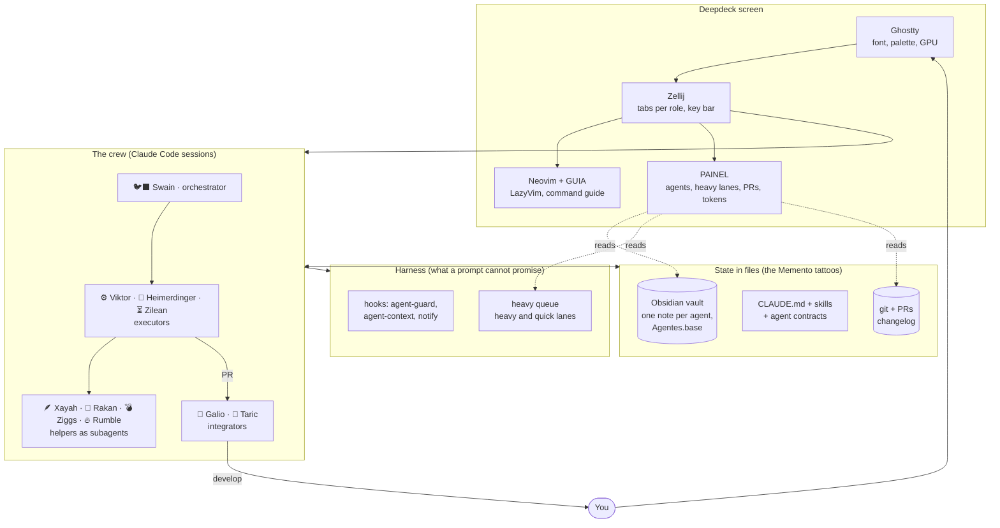

# Deepdeck

**One developer, a team of agents.** Deepdeck is the personal development environment of a solo founder: the
terminal, the editor and a crew of Claude Code agents in one calm screen. You decide what to build and you review
what comes back. The agents plan, write, test and keep the paperwork, each one with its own role.

It started as the work environment of FoodBot (a SaaS for iFood restaurants, built by one person and a dozen
agents), and it is the "at home" version of the talk *Card #2187 · Pare de conversar. Delegue.*

## The idea

Three limits drive every decision here:

1. **Context is finite.** The more an agent reads, the worse it answers (the "smart zone" and the "dumb zone").
   So each agent gets a small, focused job and a fresh session.
2. **An agent wakes up with no memory** (like Leonard in *Memento*). So the state lives in files that the agent
   reads when it starts: the rules, the agent note, the ticket, git.
3. **A promise is not evidence.** "The tests passed" does not count. Hooks, a heavy-command queue and one full
   check per pull request give the real output.

From these limits come the four rules of the crew:

- **One decides, many execute** (orchestrator-workers). The orchestrator plans and delegates; it does not edit code.
- **One owner per area.** Backend and app have separate executors and separate integrators, so two agents never
  edit the same file.
- **The author never merges.** An integrator reviews and merges to `develop`. Only the human merges to `main`,
  deploys and touches secrets.
- **The human spends attention at the start and the end.** At the start: what to build (the interview, the
  ticket). At the end: the review by risk. The middle belongs to the harness.

## Architecture



| Layer | Tool | Job |
|---|---|---|
| Terminal | Ghostty | Native and light on the GPU; JetBrains Mono 16, soft palette, Option as Alt |
| Multiplexer | Zellij | One tab per role, agent panes that start suspended (ENTER starts the agent), the key bar |
| Editor | Neovim (LazyVim) | The code, with the GUIA pane next to it while you learn the keys |
| Panel | `scripts/deepdeck-panel.sh` | Agents and their status, the diary, the heavy lanes, open PRs, tokens of the day |
| Agents | Claude Code | One session per role, started with `deepdeck agent <name>` or the AGENTES menu |
| Memory | Obsidian vault, git | One note per agent (status, task, PR, block, next step); the source of truth |
| Harness | hooks, `heavy` | Hard limits (no merge to main, no secrets), one verification per PR, notifications |

## The crew

Every agent takes the name of a League of Legends champion. The emoji and the colour come from one table
(`11-Agentes/Identidade.md` in the vault), which the scripts read.

| | Agent | Role | Model | Session |
|---|---|---|---|---|
| 🐦‍⬛ | **Swain** | Orchestrator: plans the version, writes the tickets, decides with you, runs the release | Opus | fixed |
| 🗿 | **Galio** | Backend integrator: reviews and merges service PRs, owns the migration queue | Opus | fixed |
| 💎 | **Taric** | App integrator: design fidelity, reviews and merges app PRs | Opus | fixed |
| ⚙️ | **Viktor** | Backend executor: plans and writes the service features | Opus | fixed |
| 🔧 | **Heimerdinger** | App executor: plans and writes the Flutter screens | Opus | fixed |
| ⏳ | **Zilean** | Full-stack AI: the assistant, calibration, pricing, the lab | Opus | fixed |
| ⛓️ | **Thresh** | Full-stack integrations: iFood, the WhatsApp bot, the landing, the alerts | Opus | on demand |
| 🎩 | **Lupin** | Marketing, design, PDFs and product copy | Sonnet | on demand |
| 🪝 | **Pyke** | Dead code and refactor | Sonnet | on demand |
| 🪶 | **Xayah** | Code helper of Viktor | Sonnet | subagent |
| 🌹 | **Rakan** | Code helper of Heimerdinger | Sonnet | subagent |
| 💣 | **Ziggs** | Mechanical helper of Viktor: tests, regressivo, search, vault | Haiku | subagent |
| 🔥 | **Rumble** | Mechanical helper of Heimerdinger: analyze, format, tests | Haiku | subagent |

A ticket passes six gates, and a failure goes back one gate: **Ready** (Swain) → **Build**, tests first
(executor) → **Candidate** → **Review** (Galio or Taric; Lupin for text) → **Train** (merge in batches, one
verification) → **Regressivo** (Ziggs, Rumble) → release, with your OK.

## Tabs

| Key | Tab | What is in it |
|---|---|---|
| Option+1 | NVIM | Neovim (70 %) and the GUIA (30 %) |
| Option+2 | PAINEL | Left: agents and diary. Right: machine, PRs, tokens |
| Option+3 | 🗿⚙️ BACKEND | Galio and Viktor |
| Option+4 | 💎🔧 APP | Taric and Heimerdinger |
| Option+5 | 🐦‍⬛⏳ SWAIN | Swain and Zilean |
| Option+6 | EXTRA | Thresh, Lupin, Pyke on demand |
| Option+7 | AGENTES | fzf menu: Enter starts a session, Ctrl-R resumes one |

Other keys, in every Zellij mode (also inside Neovim): **Option+arrows** go to the next pane, **Option+g** shows
the focused pane on the full screen (it hides the guide) and back. The key bar at the bottom shows the rest.

## Palette (Deepdeck soft)

| Role | Colour |
|---|---|
| Background | `#0e0e14` |
| Text | `#d8dae5` |
| Active (magenta) | `#e8457a` |
| Details (cyan) | `#4cc9d6` |
| Alerts (yellow) | `#e6c84c` |
| Dim and comments | `#878ca6` (5.8:1 on the background, WCAG AA) |

## Contents

| Path | What it is |
|---|---|
| `stow/ghostty`, `stow/zellij`, `stow/nvim` | The screen: terminal, multiplexer (theme, keys, layouts), editor |
| `stow/zsh`, `stow/git`, `stow/starship` | The shell: the `deepdeck` command, aliases, prompt, git |
| `scripts/deepdeck-*.sh` | Panel, agent menu, guide, macOS notification |
| `scripts/00-*.sh` … `40-*.sh`, `install.sh`, `update.sh` | Install and update (Homebrew, stow, Zellij plugins) |
| `docs/guia-nvim.txt` | The Neovim guide. Format: `## SECTION` and `key \| what it does` |
| `library/` | Cheat sheets, notes and snippets |
| `Brewfile` | Homebrew packages and fonts |

## Install and use

```sh
./install.sh          # Homebrew, the Brewfile, stow, the Zellij plugins
deepdeck              # open or go back to the deepdeck session
deepdeck agents       # the agent menu
deepdeck agent viktor # one agent in this pane
deepdeck reset        # delete the session (a new layout applies on the next open)
deepdeck help         # all commands
```

The agent launcher (`foodbot-ops/bin/agent`) and the agent files (`.claude/agents/*.md`) live in the project
repository, not here: Deepdeck is the screen and the habits; the project brings its own crew.

## History

The first commit comes from the environment of 17/11/2026 (the old repository HenriqueMachine/AntaresOS, now
archived), without its history.
